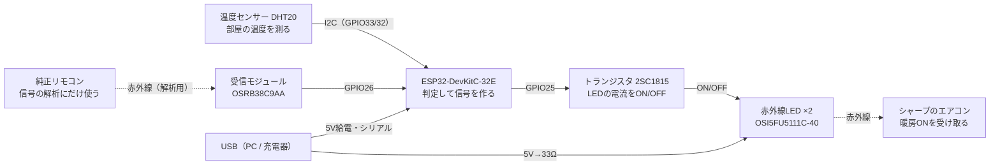
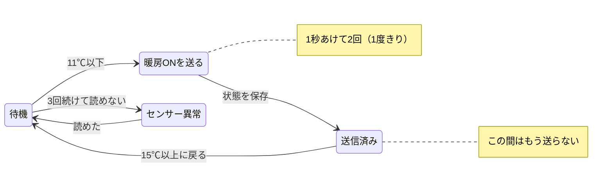

# ESP32エアコン自動ON装置 概要設計

2026-11-25 · 原本: [Claude Docs](https://claude.ai/artifact/8zR8EWeEeicN2vnAZ6B5FM)

## 目的とスコープ

室温が11℃以下になったら、シャープのエアコンを赤外線で自動的に暖房ONにする装置を作る。部品は購入済みで、ESP32上でC++（Arduino）で実装する。

**初版でやること**

- 室温を1分ごとに測る
- 11℃以下になったら、暖房ONの信号を送る
- 一度送ったら、室温が戻るまで同じ信号を送り続けない
- 動作の様子をシリアルにログとして出す

**初版でやらないこと**（「将来拡張」で扱う）

- 暖かくなったときの自動OFF
- スマホからの操作や通知
- 温度ログの保存とグラフ表示

## システム構成

ESP32が中心で、温度センサーから温度を読み、トランジスタ越しに赤外線LEDを光らせてエアコンに信号を送る。受信モジュールと純正リモコンは、開発中に信号の形式を調べるためだけに使う。

## ハードウェア設計

部品はすべてブレッドボードに挿すだけで、はんだ付けはいらない。電源はESP32のUSBから取り、LEDだけ5V、それ以外は3.3Vで動かす。

**部品とピンの割り当て**

| 部品 | 型番 | つなぐ先（ESP32側） |
| --- | --- | --- |
| マイコン | ESP32-DevKitC-32E | ― |
| 温度センサー | DHT20 | VDD→3V3、GND→GND、SDA→GPIO33、SCL→GPIO32 |
| プルアップ抵抗 | 10kΩ ×2 | 3V3–SDA、3V3–SCL に1本ずつ |
| 赤外線受信 | OSRB38C9AA | VCC→3V3、GND→GND、OUT→GPIO26 |
| トランジスタ | 2SC1815 | ベース→抵抗1kΩ→GPIO25、エミッタ→GND |
| 赤外線LED | OSI5FU5111C-40 ×2 | 5V→33Ω→LED→LED→トランジスタのコレクタ |

**回路のポイント**

- 受信モジュールは3.3Vで動かす。出力も3.3Vになるので、ESP32のピンを傷めない
- LEDの電流は (5V − 1.35V×2 − 0.25V) ÷ 33Ω ≒ 60mA。LEDの上限100mAに対して余裕がある
- 2SC1815の足の順は、平らな面を手前にして左からE・C・B。挿す前にデータシートで確かめる
- LEDは足の長い方がアノード（＋）。向きを逆にすると光らない
- DevKitCは幅が広いので、ブレッドボード1枚だと片側の列しか使えない。使う足（3V3・5V・GND・GPIO25/26/32/33）はすべて3V3側の列にあるので、その列だけを挿し、反対側ははみ出させる
- I2Cは標準ピン（GPIO21/22）ではないので、`Wire.begin(33, 32)` でピンを指定する

## ソフトウェア設計

役割ごとに4つのクラスに分け、`loop()` はそれを順に呼ぶだけにする。センサーや赤外線の部分を差し替えても、判定のロジックに影響しないようにするため。

| クラス | 役割 | 使うライブラリ |
| --- | --- | --- |
| TempSensor | DHT20から温度を読み、直近3回の平均を返す。読めなければ失敗を返す | DHT20（Rob Tillaart版、インストール済み） |
| Controller | 温度から状態を更新し、信号を送るかどうかを決める | なし（純粋なC++） |
| AcRemote | シャープの「暖房ON」信号を組み立てて送る | IRremoteESP8266（IRSharpAc） |
| Logger | 温度・状態・送信をシリアルに出す | なし（Serial） |

**loop() の流れ（1分ごと）**

1. TempSensorで温度を読む
2. Controllerに温度を渡して、次の状態を決める
3. 「送る」と判定されたときだけ、AcRemoteで信号を送る
4. Loggerで結果を出す

待ち時間は `delay()` で止めずに `millis()` で測る。後でWi-FiやMQTTを足したとき、その処理を止めないため。Controllerはハードに依存しないので、PC上でユニットテストできる。

## 制御仕様

11℃以下で一度だけ暖房ONを送り、15℃以上に戻るまでは次を送らない。しきい値を単純に「11℃以下なら送る」にすると、11℃付近で何度も送信してしまうため。

状態は「待機」「暖房ONを送る」「送信済み」「センサー異常」の4つ。送信済みから待機に戻るのは、15℃以上になったときだけ。

| 項目 | 初期値 | 理由 |
| --- | --- | --- |
| ONする温度 | 11℃以下 | 要件どおり |
| 次の送信を許す温度 | 15℃以上 | 4℃の幅を持たせて、しきい値付近での繰り返しを防ぐ |
| 測定間隔 | 60秒 | 室温はゆっくり変わるので十分 |
| 判定に使う値 | 直近3回の平均 | 一瞬のノイズで送信しない |
| 送る内容 | 暖房・20℃・風量自動・電源ON | 初版の仮の値。純正リモコンの信号を読んで合わせる |
| 送る回数 | 判定時に1回だけ、1秒あけて2回 | 赤外線は届いたか確認できないので、取りこぼしに備える |
| 送信後の休み | 30分 | 起動中だけ millis() で計る。電源が切れると時刻が分からなくなるので、再起動への備えは時刻ではなく「送信済み」の状態を保存して行う |

シャープの信号は「電源ON」と「設定変更」で中身が少し違う。IRSharpAcで電源ONとして組み立て、純正リモコンの信号と一致するかを受信で確かめる。

## 異常系

迷ったときは「送らない」側に倒す。間違って暖房を付け続けるより、一回つかない方が被害が小さいため。

| 起きること | ふるまい |
| --- | --- |
| センサーが読めない | 3回続けて失敗したら「センサー異常」にして送信を止める。読めたら待機に戻る |
| ありえない値（−20℃未満、50℃超） | その値は捨て、失敗1回と数える |
| 電源が切れて再起動した | 保存しておいた状態から再開する。「送信済み」で止まっていたら、15℃以上に戻るまで送らない（状態はESP32内の不揮発メモリに Preferences で保存） |
| 送った後に人が手でOFFにした | 15℃以上に戻るまでもう送らない。人の操作を優先する |
| エアコンがすでにON | 暖房ONを送ると設定が上書きされる。初版では許容する（エアコンの状態は読めない） |
| 信号が届かない | 装置からは分からない。設置時に距離と向きを確認しておく |

Wi-Fiは初版では使わないので、回線が切れても温度制御には影響しない。

## 開発ステップとテスト方針

部品を1つずつ足し、各ステップで動作を確かめてから次へ進む。動かないときに原因を絞りやすくするため。

- [ ] **1. 開発環境**：arduino-cliでESP32の環境を作り、シリアルに文字が出れば完了
- [ ] **2. 温度センサー**：DHT20の温度が表示され、指で温めると値が上がれば完了
- [ ] **3. リモコン解析**：IRrecvDumpV2で純正リモコンの暖房ONを読み、「SHARP_AC」と判定されれば完了
- [ ] **4. 赤外線送信**：IRSharpAcで暖房ONを送り、エアコンが反応すれば完了。LEDの点灯はスマホのカメラ越しに見えることがある
- [ ] **5. 合体**：しきい値を一時的に「今の室温＋1℃」にして、自動でONになれば完了
- [ ] **6. 常設**：直射日光とエアコンの風が当たらない場所に置き、24時間動かしてログを確かめる

Controllerの状態遷移は、温度の並び（例：12→11→10→13→16℃）を渡して「送るのは1回だけ」を確かめるテストをPC上で書く。

## 将来拡張

| 拡張 | 中身 | 学べること |
| --- | --- | --- |
| 時刻条件 | NTPで時刻を取り、「夜だけ」などの条件を足す | NTP、時刻同期 |
| 温度の送信 | MQTTで温度と状態をサーバーに送る | Pub/Sub、QoS、再接続 |
| 記録と可視化 | サーバー側で時系列DBに保存し、グラフで見る | 時系列DBの設計、ダッシュボード |
| 遠隔操作と通知 | スマホからON/OFFし、送信したら通知する | 冪等性、状態の同期 |
| 自動OFF | 暖まったら暖房を切る | 制御の安全設計 |
| OTA更新 | Wi-Fi越しにプログラムを書き換える | 署名付き配信 |

**セキュリティで守ること**

- Wi-Fiのパスワードは `secrets.h` に分け、Gitには入れない
- MQTTはTLSと認証を付け、この装置が書き込めるトピックを限る
- 外から操作するときはポートを開けず、VPNかトンネルを使う
